<a href="https://hsk10x2.vercel.app"></a>

<a href="https://github.com/10x4hs"></a>

```text
frontier   Physical AI · ZK · DeFi protocols · Harness / Orchestration engineering
tools      PyTorch · Python · Claude Code · Cloudflare · TypeScript · Java
school     Daedeok Software Meister HS — Student Body Vice President (12th)
community  DsmMFA — Community Leader & CMO · Highference organizer
before     Konyang Univ. Gifted Center for Information Security (2024)
```

### Built.

- **[SWx2](https://github.com/10x4hs/SWx2)** — study planner, Obsidian-style notes and AI tutors in one app · [live ↗](https://swx2.swx2.workers.dev)  
  <sub>`Cloudflare Workers` `D1` `Vectorize`</sub>
- **[Uwts](https://github.com/10x4hs/Uwts)** — synced, word-by-word lyrics beside any music video  
  <sub>`TypeScript` `Chrome MV3`</sub>
- **[偕讀 Haedok](https://github.com/10x4hs/Saipr_project)** — read the same book with friends, each at your own pace  
  <sub>`Python` `JavaScript`</sub>
- **[oh-my-dm-discord](https://github.com/10x4hs/oh-my-dm-discord)** — all your DMs in one terminal messenger  
  <sub>`TypeScript` `TUI`</sub>
- **[Gehry](https://gehry55.vercel.app) · [Ando](https://ando55.vercel.app)** — famous buildings rebuilt in web 3D from LiDAR data  
  <sub>`Three.js`</sub>
- **[hsk10x2.vercel.app](https://hsk10x2.vercel.app)** — my NFC business card: WebGL halftone field, assembling type, 3D books  
  <sub>`WebGL` `GLSL` `Canvas`</sub>

### Writing.

**Zero to One** — a weekly newsletter on going from 0 to 1, read by 637 subscribers. [Subscribe on LinkedIn ↗](https://www.linkedin.com/in/10x4hs/)




<p align="center"><sub><i>My beginning is small, but I will make the end great.</i></sub></p>

<p align="center">
  <a href="https://hsk10x2.vercel.app">hsk10x2.vercel.app</a> &nbsp;·&nbsp;
  <a href="https://www.linkedin.com/in/10x4hs">LinkedIn</a> &nbsp;·&nbsp;
  <a href="mailto:1gmltjd0@gmail.com">1gmltjd0@gmail.com</a>
</p>
